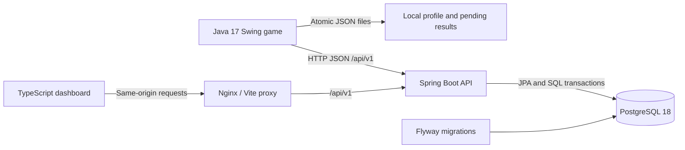

# Bank Heist Game Services

A playable **Java 17 Swing bank-heist game** with a separate **Spring Boot and PostgreSQL backend**. Completed wins and losses feed persistent player statistics, seven quests, and global leaderboards. A TypeScript dashboard and an in-game services window display the same API data.

The desktop client owns movement, guards, collectibles, scoring, timing, and the outcome. The server stores completed results, updates quest progress, and answers statistics and leaderboard queries. This extends the original five-person Simon Fraser University game project into a small game-services system that can evolve independently of the game loop.

**Verification:** 222 core/gameplay tests, strict TypeScript checks, 12 dashboard tests, and the Maven wrapper have passed locally. Full Maven, HTTP/outbox, backend, PostgreSQL, Vite production, and Compose checks remain pending. See [the verification record](docs/VERIFICATION.md) for scope and evidence.

[Watch the original gameplay demo](https://youtu.be/ZiidlGFFCcc) | [Play the legacy browser demo](https://osman-mohamad-eng.github.io/bank-robber-chase-game/)

The browser demo is the existing standalone game in `docs/`; it does not submit results to the new backend. The Java desktop game is the integrated game-services client.


## Features

- Play the existing five levels with WASD, collect all required cash stacks, and reach the exit while avoiding guards and traps.
- Record each terminal attempt with its player, level, gross cash, diamonds, penalties, final score, active time, outcome, and timestamps.
- View lifetime statistics, recent results, quest progress, and one best result per player on each leaderboard.
- Continue playing when the API is unavailable; a local outbox retains results for retry.

## Architecture



| Component | Technologies and responsibility |
| --- | --- |
| Desktop game | Java 17, Swing, JDK HTTP client, Gson; gameplay and result capture |
| API | Spring Boot 4.1.1, Spring MVC, Bean Validation, Spring Data JPA, PostgreSQL queries |
| Database | PostgreSQL 18, Flyway migrations, constraints, indexes, transactional quest updates |
| Dashboard | Strict vanilla TypeScript 6.0.3, Vite 8.0.0, Nginx; statistics, quests, history, leaderboards |
| Build and tests | Maven Wrapper 3.3.4 / Maven 3.9.11, JUnit, Mockito, Testcontainers, Node test runner |
| Local infrastructure | Dockerfiles and Docker Compose with health checks and persistent database storage |

Flyway creates four tables: `players`, `heist_sessions`, `quest_definitions`, and `player_quests`. See [architecture and data semantics](docs/ARCHITECTURE.md) for their relationships, transaction boundaries, ordering, and tradeoffs.

## Start the local services

Install Docker with a working engine and the Compose plugin. Docker builds the API and dashboard; host Java and Node are optional for this step.

From the repository root in PowerShell:

```powershell
Copy-Item .env.example .env
```

Edit `.env` and choose your own `DB_PASSWORD`. Then start all three services:

```powershell
docker compose up --build --wait
```

On Linux/macOS, use `cp .env.example .env` for the copy step. The Compose command is identical.

| Service | Local address |
| --- | --- |
| Dashboard | http://localhost:3000 |
| REST API | http://localhost:8080/api/v1 |
| API readiness | http://localhost:8080/actuator/health/readiness |
| PostgreSQL | `localhost:5432`, database/user `bankheist` by default |

Published ports bind to `127.0.0.1`. `.env` supports `DB_NAME`, `DB_USERNAME`, `DB_PASSWORD`, `DB_PORT`, `API_PORT`, and `DASHBOARD_PORT`. PostgreSQL data lives in the named `postgres_data` volume. `docker compose down` stops the project while retaining that data.

Docker execution has not yet been verified in this development environment. Kubernetes manifests are deferred until the local Compose/PostgreSQL/API checks pass.

## Build and play the desktop game

Install a JDK 17 and set `JAVA_HOME` to that installation. A separate Maven installation is unnecessary; the wrapper downloads its pinned distribution on first use.

```powershell
.\mvnw.cmd -f BankHeist/pom.xml clean package
java -Dbankheist.username=Your_Name -Dbankheist.level=3 -jar BankHeist/target/BankHeist-1.0-SNAPSHOT.jar
```

On Linux/macOS, replace `.\mvnw.cmd` with `bash ./mvnw`. The packaged game includes its JSON dependency. Choose levels `1` through `5`; the default remains level `3`.

Use **WASD** to move and **Escape** to pause/resume. Open **Game services** in the menu bar to view server data and copy your player UUID. Enter that UUID in the dashboard to load your statistics, quests, and history. Global leaderboards can be viewed without selecting a player.

The client defaults to `http://localhost:8080`. Override the server origin with `-Dbankheist.apiUrl=http://localhost:8080` or `BANK_HEIST_API_URL`; do not include `/api/v1`. `BANK_HEIST_USERNAME` is an alternative to the username property.

### Identity and offline results

The first launch creates `~/.bankheist/profile.json` with a UUID and username. Usernames contain 3-32 ASCII letters, digits, underscores, or hyphens and are unique without regard to case. Later launches reuse the saved identity; changing the launch username does not replace an existing profile. Use `-Dbankheist.dataDir=<directory>` for a separate local profile.

Pending attempts are stored under `~/.bankheist/pending/`, submitted away from Swing's event thread, and retried every 15 seconds while the game is open. Normal shutdown makes a final attempt to preserve queued results. Permanent API rejections are retained in `pending/failed/` with an error file. A hard crash before the background writer saves a new result can still lose that result.

If a new local UUID chooses an already-used username, close the game, select an unused username in `profile.json` **without changing `playerId`**, move affected result JSON files from `pending/failed/` back into `pending/`, and restart. If the UUID is already registered, retain its registered username. Keep a backup while correcting files; deleting the profile creates a new UUID and disconnects it from old pending attempts.

### Scoring and timing

```text
finalScore = cashCollected + 500 * diamondsCollected - penaltiesIncurred
```

`ScoringRules` defines a cash stack as 100, a diamond as 500, and an ink-dart penalty as 150. `cashCollected` is gross cash from stacks, before penalties and excluding diamonds. Negative final scores are valid losses. Quest reward points are separate profile rewards and never change the game score.

Completion time is active gameplay in milliseconds. Pauses, menus, and the opening transition are excluded. A completed movement tick resolves guard capture before escape and publishes one outcome. Returning to the menu or quitting an unfinished attempt does not create a completed result.

## Quests

Quest progress updates when the server accepts a new completed result. Each quest grants its reward once; completing all seven grants **650 profile points**.

| Quest | Requirement | Reward |
| --- | --- | ---: |
| Cash Haul | Collect 2,000 gross cash in one heist | 100 |
| Diamond Collector | Collect 3 diamonds across completed heists | 75 |
| First Escape | Win one heist | 50 |
| Speed Run | Win in strictly less than 60 seconds | 100 |
| Five Heists | Finish 5 heists, with either outcome | 75 |
| Cash Career | Collect 10,000 gross cash across completed heists | 150 |
| High Score | Reach a final score of 3,000 in one heist | 100 |

## API examples

All paths below are relative to `http://localhost:8080/api/v1`.

| Method and path | Purpose |
| --- | --- |
| `POST /players` | Register a player, or retrieve the matching registration |
| `POST /heists` | Submit a completed attempt; retry the same UUID and payload safely |
| `GET /heists/{sessionId}` | Retrieve one completed attempt |
| `GET /players/{playerId}/stats` | Lifetime statistics and personal bests |
| `GET /players/{playerId}/history?level=3&limit=20&offset=0` | Paginated completed results |
| `GET /players/{playerId}/quests` | Quest progress and reward points |
| `GET /leaderboards/score?level=3&limit=20&offset=0` | Highest final score |
| `GET /leaderboards/money?level=3&limit=20&offset=0` | Most gross cash collected |
| `GET /leaderboards/time?level=3&limit=20&offset=0` | Fastest successful completion |

Omit `level` for all levels. History and leaderboard pages use `limit` 1-100 (default 20) and nonnegative `offset`; responses contain `items`, `limit`, `offset`, and `total`.

Post this registration to `/players` with `Content-Type: application/json`:

```json
{
  "playerId": "11111111-1111-4111-8111-111111111111",
  "username": "Example_Player"
}
```

Then post a result to `/heists`:

```json
{
  "sessionId": "22222222-2222-4222-8222-222222222222",
  "playerId": "11111111-1111-4111-8111-111111111111",
  "level": 3,
  "cashCollected": 2300,
  "diamondsCollected": 3,
  "penaltiesIncurred": 150,
  "finalScore": 3650,
  "completionTimeMs": 45000,
  "outcome": "WON",
  "completedAt": "2026-10-18T20:00:00Z"
}
```

A new registration/result returns `201`; an identical retry returns `200`. Reusing a session UUID with different data returns `409`. Validation errors return `400`; missing players or results return `404`. The server records its own `receivedAt` in addition to the client completion timestamp.

Leaderboards show one best attempt per player. Money and score boards include wins and losses; the time board includes wins only. Fastest and average completion statistics also use wins only and are `null` before the first win. Exact tie ordering is documented in [ARCHITECTURE.md](docs/ARCHITECTURE.md).

## Development and verification

For host development, use JDK 17 and Node.js 24, matching the Docker builds. Start PostgreSQL separately or use `docker compose up -d db`. The backend reads `DB_URL`, `DB_USERNAME`, and `DB_PASSWORD`; loading `.env` into Compose does not set those variables in your shell.

```powershell
$env:DB_URL = "jdbc:postgresql://localhost:5432/bankheist"
$env:DB_USERNAME = "bankheist"
$env:DB_PASSWORD = "your-local-password"
.\mvnw.cmd -f backend/pom.xml spring-boot:run
```

In another terminal:

```powershell
npm --prefix web install
npm --prefix web run dev
```

Vite serves `http://localhost:5173` and proxies API requests to port 8080. The Compose dashboard uses Nginx on port 3000.

```powershell
.\mvnw.cmd test
.\mvnw.cmd -f backend/pom.xml -Pintegration verify
npm --prefix web run build
.\scripts\verify-compose.ps1
```

The integration profile needs Docker and tests against PostgreSQL 18 through Testcontainers. `verify-compose.ps1` needs Docker and Node; it starts services, runs `scripts/smoke-api.mjs`, and checks the dashboard response. The smoke script creates a persistent test player and results, and deletes nothing. The [verification workflow](.github/workflows/verify.yml) also defines a service-restart persistence check for CI; no successful CI run has been claimed. See [VERIFICATION.md](docs/VERIFICATION.md) before interpreting commands as completed checks.

## Repository layout

```text
BankHeist/             Existing Java desktop game and client integration
backend/               Independent Spring Boot API, migrations, and tests
web/                   TypeScript dashboard and Nginx container
scripts/               API and Compose smoke checks
.mvn/ + mvnw*          Pinned Maven wrapper
docker-compose.yml     Local PostgreSQL, API, and dashboard
docs/                  Architecture, verification, and original browser game
Design/ + Documents/   Original project material
```

The root Maven project aggregates the independent game and backend builds. Historical game documentation is preserved in [docs/BankHeist-README.md](docs/BankHeist-README.md).

This is a local development system. Player UUIDs are identifiers, not credentials: the API has no authentication and accepts client-reported outcomes and scores. Production work would require authenticated identities, abuse controls, a stronger result-trust model, TLS, monitoring, and database backup/recovery. Kubernetes remains a later phase after local verification.
