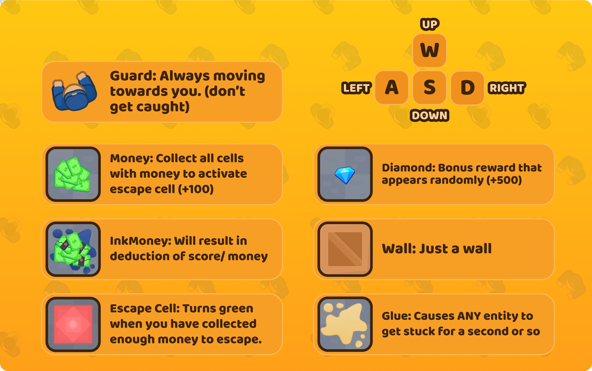
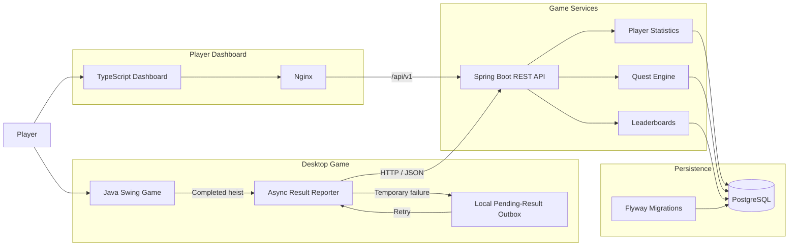

# Bank Heist — Game Services Platform

A playable **Java 17 bank-heist game** extended into a full **game-services platform** with persistent player statistics, backend-evaluated quests, heist history, global leaderboards, a responsive web dashboard, and containerized deployment.

The system combines a **Java Swing desktop client**, **Spring Boot REST API**, **PostgreSQL**, **TypeScript dashboard**, **Docker Compose**, and **Kubernetes**.

> Originally developed as a five-person software engineering project at Simon Fraser University, the game has since been expanded into a portfolio-scale game-services architecture focused on backend systems, persistence, reliability, and player progression.

## Highlights

- Persistent player profiles and completed heist history
- Global **score, cash, and fastest-completion leaderboards**
- Seven server-evaluated quests with persistent progression
- Lifetime statistics including wins, losses, win rate, cash, diamonds, and personal bests
- Idempotent game-result submission using unique session IDs
- Asynchronous result reporting that does not block the Swing game loop
- Local pending-result outbox for temporary API/network failures
- PostgreSQL persistence with Flyway-managed schema migrations
- Responsive TypeScript dashboard for statistics, quests, history, and rankings
- Docker Compose development environment for API, database, and dashboard
- Kubernetes deployment with Services, health probes, persistent database storage, and resource limits
- Automated game, backend, and dashboard test suites

## Demo

[▶ Watch the original gameplay demo](https://youtu.be/ZiidlGFFCcc)

The original Java game remains fully playable. The new backend services operate alongside the desktop client and persist player progression across game sessions.



---

## Architecture



The desktop game remains responsible for gameplay: movement, guards, collectibles, traps, timing, scoring, and determining the final outcome.

The backend is responsible for persistent game services: player identity, completed sessions, statistics, quest progression, history, and global rankings.

See [`docs/ARCHITECTURE.md`](docs/ARCHITECTURE.md) for a deeper architecture breakdown.

---

## How a Heist Becomes Persistent Game Data

A completed run moves through the system like this:

```text
Player finishes heist
        ↓
Game creates immutable result snapshot
        ↓
Async result reporter
        ↓
Spring Boot REST API
        ↓
Validate + enforce idempotency
        ↓
PostgreSQL transaction
        ↓
Update quest progression
        ↓
Statistics / history / leaderboards
        ↓
Desktop services view + web dashboard
```

Each completed session records:

- Player UUID
- Session UUID
- Level
- Gross cash collected
- Diamonds collected
- Penalties incurred
- Final score
- Active completion time
- Win/loss outcome
- Client completion timestamp
- Server receipt timestamp

A single attempt UUID can be safely retried. An identical retry returns the existing result rather than inserting a duplicate session or granting quest rewards twice.

---

## Game Services

### Player Statistics

The backend computes persistent player statistics including:

- Games played
- Wins and losses
- Win rate
- Lifetime cash collected
- Lifetime diamonds collected
- Highest single-heist score
- Highest single-heist cash
- Fastest successful completion
- Average successful completion time
- Quest reward points

### Global Leaderboards

Three server-backed leaderboards are available:

| Leaderboard | Ranking |
| --- | --- |
| **Highest Score** | Best final score per player |
| **Most Cash** | Highest gross cash collected in one heist |
| **Fastest Heist** | Fastest successful completion per player |

Leaderboards support:

- One best result per player
- Optional level filtering
- Pagination
- Deterministic tie-breaking
- Stable ordering

The time leaderboard includes successful heists only.

### Quests

Quest progress is evaluated **server-side from accepted game-session data** rather than trusting the client to report that a quest was completed.

| Quest | Requirement |
| --- | --- |
| **Cash Haul** | Collect at least $2,000 cash in one heist |
| **Diamond Collector** | Collect 3 diamonds across completed heists |
| **First Escape** | Win a heist |
| **Speed Run** | Complete a successful heist in under 60 seconds |
| **Five Heists** | Finish 5 heists |
| **Cash Career** | Collect $10,000 lifetime cash |
| **High Score** | Reach a final score of 3,000 |

Quest progress and rewards are persisted in PostgreSQL and updated transactionally when a new completed result is accepted.

---

## Reliability and Offline Result Handling

Game-service requests are performed asynchronously so network traffic does not block the Swing event thread.

If the API is temporarily unavailable:

```text
Completed heist
      ↓
Save result locally
      ↓
Continue playing normally
      ↓
Retry when API becomes available
      ↓
Submit same session UUID
      ↓
Backend prevents duplicates
```

Temporary transport failures and retryable HTTP responses preserve pending results for later submission.

Permanent failures are separated for inspection rather than retried indefinitely.

This allows gameplay and result reporting to remain decoupled.

---

## Technology Stack

| Layer | Technologies |
| --- | --- |
| Desktop game | Java 17, Swing, Maven |
| Game-service client | JDK HTTP Client, Gson, asynchronous reporting |
| Backend | Spring Boot, Spring Web, Bean Validation |
| Persistence | PostgreSQL, Spring Data JPA, SQL |
| Schema management | Flyway |
| Dashboard | TypeScript, Vite, HTML/CSS |
| Web serving | Nginx |
| Testing | JUnit, Mockito, Testcontainers, Node test runner |
| Local infrastructure | Docker, Docker Compose |
| Orchestration | Kubernetes |
| Build / CI | Maven Wrapper, GitHub Actions |

---

## Database Model

The primary PostgreSQL tables are:

```text
players
   │
   ├──< heist_sessions
   │
   └──< player_quests >── quest_definitions
```

### `players`

Stores persistent player identity.

### `heist_sessions`

Stores immutable completed game attempts including:

```text
session_id
player_id
level
cash_collected
diamonds_collected
penalties_incurred
final_score
completion_time_ms
outcome
completed_at
received_at
```

### `quest_definitions`

Defines available quests, progression metrics, targets, and rewards.

### `player_quests`

Stores per-player quest progress and completion state.

Database structure is managed through versioned Flyway migrations.

---

## REST API

All game-service endpoints are exposed under:

```text
/api/v1
```

| Method | Endpoint | Purpose |
| --- | --- | --- |
| `POST` | `/players` | Register or resolve a player |
| `POST` | `/heists` | Submit a completed heist |
| `GET` | `/heists/{sessionId}` | Retrieve one completed result |
| `GET` | `/players/{playerId}/stats` | Player lifetime statistics |
| `GET` | `/players/{playerId}/history` | Paginated heist history |
| `GET` | `/players/{playerId}/quests` | Quest progress |
| `GET` | `/leaderboards/score` | Global score leaderboard |
| `GET` | `/leaderboards/money` | Global cash leaderboard |
| `GET` | `/leaderboards/time` | Global fastest-heist leaderboard |

Leaderboard and history endpoints support pagination and optional level filtering.

---

## Example Result Submission

```json
{
  "sessionId": "22222222-2222-4222-8222-222222222222",
  "playerId": "11111111-1111-4111-8111-111111111111",
  "level": 3,
  "cashCollected": 2300,
  "diamondsCollected": 3,
  "penaltiesIncurred": 150,
  "finalScore": 3650,
  "completionTimeMs": 45000,
  "outcome": "WON",
  "completedAt": "2026-10-18T20:00:00Z"
}
```

An identical retry of the same session is safe.

Reusing the same session UUID with different result data returns a conflict instead of silently corrupting the existing record.

---

## Scoring

The game keeps collection metrics separate from the final score:

```text
finalScore =
    cashCollected
    + diamond rewards
    - penaltiesIncurred
```

Current scoring constants:

```text
Cash stack       = 100
Diamond          = 500
Ink-dart penalty = 150
```

This separation lets the backend independently rank:

- gross cash collected
- final score
- completion time

without treating them as the same statistic.

---

## Player Dashboard

The responsive TypeScript dashboard provides a browser-accessible view of the same game-service data used by the desktop client.

It includes:

- Player overview
- Lifetime statistics
- Quest progression
- Heist history
- Global score rankings
- Global cash rankings
- Global completion-time rankings
- Level filters
- Loading and error states

The dashboard communicates with the Spring Boot API through the Nginx `/api` proxy.

---

## Run with Docker Compose

### Requirements

- Docker Desktop or Docker Engine
- Docker Compose

Create your local environment file:

```powershell
Copy-Item .env.example .env
```

Choose a local database password in `.env`:

```env
DB_NAME=bankheist
DB_USERNAME=bankheist
DB_PASSWORD=your-local-password
DB_PORT=5432
API_PORT=8080
DASHBOARD_PORT=3000
```

Then start the stack:

```powershell
docker compose up --build -d
```

Check service status:

```powershell
docker compose ps
```

Local services:

| Service | Address |
| --- | --- |
| Dashboard | http://localhost:3000 |
| Spring Boot API | http://localhost:8080 |
| API readiness | http://localhost:8080/actuator/health/readiness |
| PostgreSQL | localhost:5432 |

Stop the services:

```powershell
docker compose down
```

PostgreSQL data is stored in a named Docker volume and remains available across normal container restarts.

---

## Run the Desktop Game

### Requirements

- JDK 17

Build with the included Maven wrapper:

```powershell
.\mvnw.cmd -f BankHeist\pom.xml clean package
```

Launch:

```powershell
java -jar BankHeist\target\BankHeist-1.0-SNAPSHOT.jar
```

Use:

```text
WASD    Move
Escape  Pause / resume
```

The game-service client defaults to:

```text
http://localhost:8080
```

---

## Kubernetes

The project includes Kubernetes manifests under:

```text
k8s/
├── namespace.yaml
├── postgres.yaml
├── api.yaml
└── dashboard.yaml
```

The local Kubernetes deployment includes:

- Dedicated `bankheist` namespace
- PostgreSQL StatefulSet
- PersistentVolumeClaim
- Spring Boot API Deployment
- Dashboard Deployment
- Internal Kubernetes Services
- Secrets-based database configuration
- Readiness probes
- Liveness probes
- Startup probes
- CPU and memory requests/limits

The stack has been verified on a local Docker Desktop Kubernetes cluster.

Verified local state included:

```text
PostgreSQL        1/1 Running
Spring Boot API   1/1 Running
Dashboard         1/1 Running
PostgreSQL PVC    Bound
```

The dashboard was also served successfully through Kubernetes port forwarding.

> The in-cluster PostgreSQL deployment is intended for local demonstration and development. A production deployment would typically use appropriately managed and backed-up database infrastructure.

---

## Verification

Current local verification:

| Component | Result |
| --- | --- |
| Java game/client test suite | **230 / 230 passed** |
| Spring Boot backend tests | **30 / 30 passed** |
| Dashboard automated tests | **12 / 12 passed** |
| TypeScript strict checks | **Passed** |
| Docker API image | **Built successfully** |
| Docker dashboard image | **Built successfully** |
| Docker Compose | **Verified** |
| PostgreSQL container | **Healthy** |
| Spring Boot container | **Healthy** |
| Flyway database migrations | **Applied successfully** |
| Dashboard container | **Served successfully** |
| Kubernetes PostgreSQL | **1/1 Running** |
| Kubernetes API | **1/1 Running** |
| Kubernetes dashboard | **1/1 Running** |
| Kubernetes persistent volume | **Bound** |

The game and backend test suites currently report **260 passing Java tests**, with an additional **12 dashboard tests**.

No production-scale benchmark or production-readiness claim is implied by these local verification results.

---

## Project Structure

```text
bank-robber-chase-game/
│
├── BankHeist/                 Java Swing desktop game
│   └── src/
│       ├── main/
│       └── test/
│
├── backend/                   Spring Boot game-services API
│   └── src/
│       ├── main/
│       └── test/
│
├── web/                       TypeScript player dashboard
│
├── k8s/                       Kubernetes manifests
│
├── docs/
│   ├── ARCHITECTURE.md
│   └── VERIFICATION.md
│
├── scripts/                   Verification / smoke-test scripts
│
├── docker-compose.yml
├── .env.example
├── mvnw
├── mvnw.cmd
└── README.md
```

---

## Design Decisions

A few important design choices:

### Client owns gameplay

The server does not reproduce movement, collisions, or guard AI.

The desktop game determines the completed result, while the backend owns persistence and game services.

### Completed sessions are immutable

Accepted game results are stored as immutable session records.

Statistics, rankings, and quest progress are derived from those sessions.

### Quest completion is server-controlled

The client submits the session result.

The backend decides which quests progressed or completed.

### Result submission is idempotent

Network retries cannot create duplicate sessions or duplicate quest rewards.

### Gameplay does not depend on network availability

The game can continue running when the API is unavailable, with results queued locally for later retry.

---

## Current Boundaries

This is a portfolio-scale game-services architecture rather than a production multiplayer service.

Current limitations include:

- Player identity is UUID-based rather than authenticated
- Completed scores are still reported by the game client
- No anti-cheat / server-authoritative gameplay validation
- No TLS configuration for the local environment
- PostgreSQL runs locally for Docker/Kubernetes demonstrations
- No production observability or managed cloud deployment

A production version would add authenticated accounts, trusted result ingestion, rate limiting, TLS, centralized observability, backups, and managed database infrastructure.

---

## Original Project

The original Bank Heist game was developed collaboratively by a five-person software engineering team at Simon Fraser University.

The original game includes:

- Five playable maps
- Grid-based movement
- Guard pursuit
- Cash and diamond collectibles
- Trap mechanics
- Scoring
- Win/loss conditions
- Java Swing UI
- Automated gameplay tests

The portfolio version extends that game with the persistent game-services architecture documented above.

---

## Repository

**GitHub:**  
https://github.com/Osman-mohamad-eng/bank-robber-chase-game
