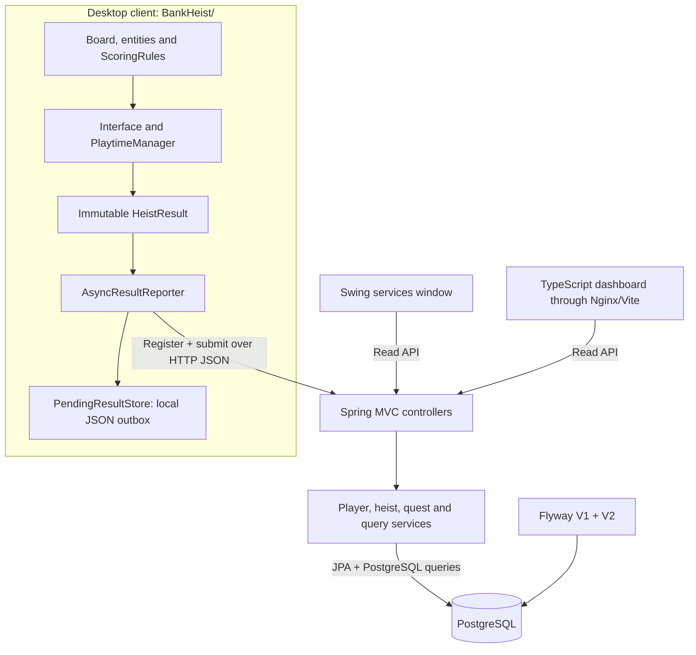
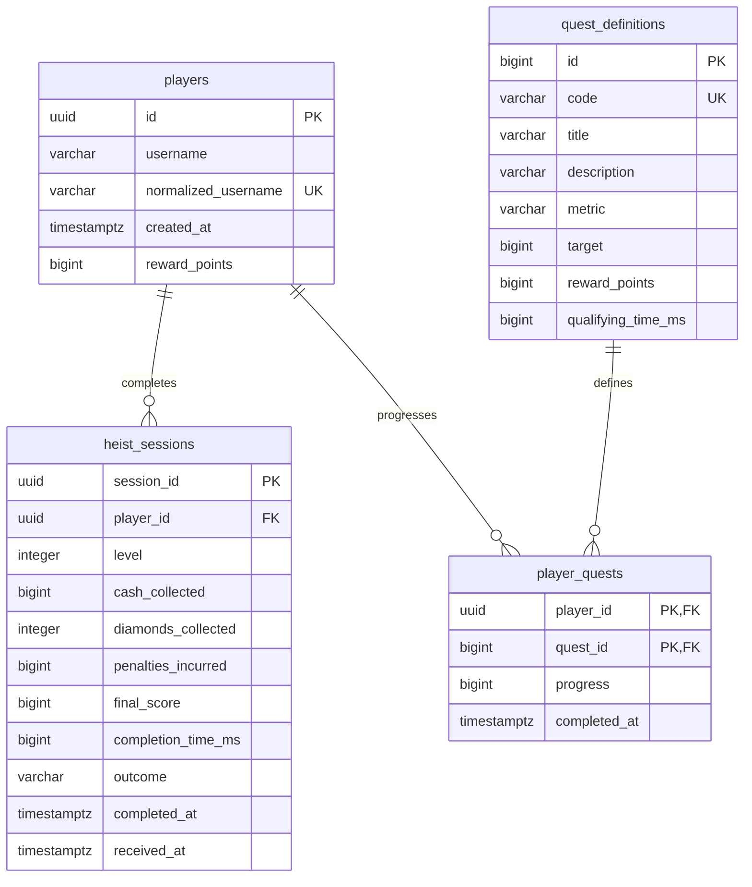

# Architecture and data semantics

The system separates an existing desktop game from a single game-services API and a relational database. The API never moves a guard, awards a cash pickup, calculates a game score, or decides whether the player escaped.

## Modules and communication

`BankHeist/` retains its Swing architecture, singleton board, entity hierarchy, factories, and `GameSession`/`GameEvents` boundary. Collection counters capture gross cash, diamonds, and penalties at the existing pickup effects. `ScoringRules` centralizes the game's existing values: 100 per cash stack, 500 per diamond, and 150 per ink dart.

`Interface` creates one attempt UUID when a game starts. It snapshots raw counters, score, active milliseconds, outcome, level, and UTC completion time before replay/menu actions can reset the board. Repeated terminal callbacks do not create another submission. The movement tick completes guard processing before committing an escape, so a guard arriving at the exit in that tick produces one loss.

`PlaytimeManager` uses monotonic time. It starts after the opening transition, pauses outside gameplay, and resumes the same attempt after a pause/tutorial. Network requests never contribute to completion time. Abandoned attempts stay a client concern; the server stores terminal results only, so no remote start-session endpoint is necessary.

`backend/` is an independently executable Spring Boot 4.1.1 application on Java 17. Controllers validate request shape, services define transactions, JPA repositories persist entities, and SQL query repositories calculate statistics and leaderboard pages. Hibernate validates the schema; Flyway owns its creation and migrations.

`web/` is a strict vanilla TypeScript application built with Vite. The production Nginx container proxies `/api/` to the API; Vite provides an equivalent development proxy. The existing JavaScript browser game in `docs/` remains a separate legacy demo.

## Database model

The executable schema is in [V1](../backend/src/main/resources/db/migration/V1__players_and_completed_heists.sql) and [V2](../backend/src/main/resources/db/migration/V2__quests_and_progress.sql).

| Table | Important invariants |
| --- | --- |
| `players` | UUID identity; case-insensitive username uniqueness through a unique normalized value; nonnegative reward balance |
| `heist_sessions` | UUID identifies one immutable terminal attempt; valid player foreign key; positive level; nonnegative collection counts, penalties and duration; outcome `WON` or `LOST` |
| `quest_definitions` | Seven seeded definitions with unique codes, positive targets/rewards, and a time threshold for fast-win quests |
| `player_quests` | One progress record per player/quest; foreign keys to both parents; completion timestamp marks a reward already earned |

`final_score` can be negative because losing money to an ink dart is an existing loss condition. The backend stores the reported score and outcome; it does not repeat the score calculation. `completed_at` comes from the client, while `received_at` is assigned by the API. Timestamp comparison normalizes to PostgreSQL microsecond precision for repeatable retries.

Indexes support player history, score and cash ordering, and a partial time index containing successful attempts. There is no separate cached leaderboard or statistics table; queries read completed sessions.

## Submission, concurrency and rewards

1. The desktop captures an immutable terminal snapshot and queues it for the background reporter.
2. The reporter atomically writes one JSON file per attempt before making HTTP requests.
3. It registers the saved local player and posts the result using the original session UUID.
4. The API validates the request and checks whether that UUID already exists. Matching data returns the existing result; conflicting data returns `409`.
5. For a new result, the transaction locks that player's row, inserts the attempt using PostgreSQL conflict handling, and updates quest progress/rewards only if the insert occurred.
6. A successful API response allows the reporter to remove the pending file. A lost response can cause another POST, which returns the stored result without granting rewards again.

The player row lock serializes concurrent new results for the same player. Different players can submit independently. The session primary key also handles duplicate UUIDs arriving concurrently. Result insertion, quest transitions, and profile reward changes commit in one transaction; failure rolls the transaction back.

Quest progress is capped at its target. Single-run quests retain the best observed value; cumulative quests add qualifying values. Wins and speed quests check the reported outcome, and speed requires strictly less than 60,000 ms. Completed quests stop awarding rewards. All seven rewards total 650 profile points, separate from game scores and leaderboard cash.

## Statistics and ranking

Statistics count completed wins/losses, gross cash and diamonds from all completed attempts, highest final score, highest gross cash, and quest reward points. Win rate is `100 * wins / gamesPlayed`, or zero with no attempts. Fastest and average completion times include successful attempts only and are `null` before the first win. Empty numeric totals and best score/cash default to zero.

Each leaderboard first selects one best attempt per player under its complete ordering, then assigns a stable global row number. The ordering is fixed server code:

| Board | Eligible attempts | Order, from highest priority to lowest |
| --- | --- | --- |
| Score | Wins and losses | Final score descending; time ascending; completion timestamp ascending; session UUID ascending |
| Money | Wins and losses | Gross cash descending; time ascending; completion timestamp ascending; session UUID ascending |
| Time | Wins only | Time ascending; final score descending; completion timestamp ascending; session UUID ascending |

Equal headline values have distinct deterministic ranks. The optional positive `level` filter applies before selecting each player's best attempt. Without a filter, all levels compete together. Pagination uses `limit` 1-100 and nonnegative `offset`; `total` counts qualifying players, not sessions. Player history counts sessions and orders newest completion first, then session UUID ascending.

## Failure handling and local storage

The local profile and pending files are separate from game entities. Each result keeps its player UUID and attempt UUID across retries. Profile mismatches and malformed pending JSON are preserved under `pending/failed/`. Permanent API rejections go there with an error explanation. A permanent registration failure stops repeated registration attempts for that reporter and preserves affected results for correction and replay.

Transport errors and HTTP `408`, `429`, or `5xx` responses retain pending work for the next retry. The interval is 15 seconds, with bounded connection/request timeouts. Normal shutdown stops the worker and attempts to persist its remaining memory queue. Disk errors are logged.

The reporter is asynchronous: there is a window between capturing a result in memory and its local atomic file write. A hard process kill or machine failure in that window can lose the new result. Atomic replacement avoids exposing half-written destination JSON; it does not promise durable capture before `submit()` returns.

## Local runtime and boundaries

Compose starts PostgreSQL 18, the API, and the dashboard in dependency order using health checks. API readiness includes database connectivity. The database uses a named volume, and all published ports bind to localhost. The API and Nginx runtime containers use non-root users.

The API accepts client-reported results and UUID identities without authentication. Request validation, database constraints and idempotency protect consistency; they do not establish that an honest game produced a score. The configured CORS origin and same-origin dashboard proxy also do not authenticate callers.

Production work would address authenticated identity, verified result ingestion, abuse limits, TLS, observability and backups. Kubernetes is deferred until actual local Compose, PostgreSQL persistence, and API verification succeed. The current design uses one API and one database so these responsibilities stay easy to inspect and discuss.
